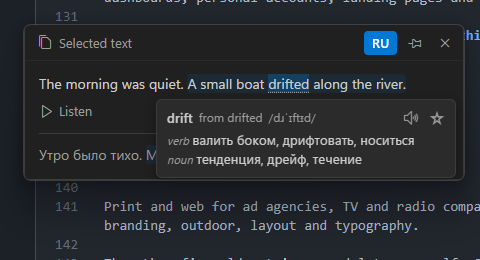

# 2Talker

Select any text, press **Ctrl+C twice**, and hear it in English. A small Windows app for people learning English: it translates what you picked, reads the English aloud, and shows the translation under it. Everything runs on your computer: nothing you read leaves it.



- **Any text.** Select it in any program and press **Ctrl+C twice**. A card opens by the pointer: the English on top, read aloud at once, your language under it. An English text shows up before its translation is in; a text in your language is translated into English first.
- **A piece of the screen.** Press **Ctrl+Alt+S** and draw a box over the words: a picture, a video with subtitles, a game. 2Talker reads the text with the OCR built into Windows.
- **Words.** Click an English word for its meanings, how it is said, and a star that keeps it in your word list. A dotted line marks the words outside the 3000 most common ones. Export the list for Anki.
- **Voice.** A natural English voice (Kokoro, 170 MB, offline) or a Windows voice, at the speed you choose, with the spoken word highlighted.

## Install

Download `2Talker-Setup-<version>.exe` from the [releases](https://github.com/ikstro/2talker/releases) and run it. The installer is not signed (2Talker is a free app), so Windows warns once: **More info → Run anyway**. 2Talker starts with Windows, lives in the tray and updates itself from the releases.

The first translation downloads the translator for your language (about 85 MB for Russian ↔ English), once.

## Use

| | |
|---|---|
| **Ctrl+C, Ctrl+C** | translate the selected text |
| **Ctrl+Alt+S** | translate a piece of the screen (changeable in the settings) |
| **Esc** | close the card and stop the voice |
| click a word | its meanings · say it · save it |
| click a sentence | mark its translation |
| **RU** (your language's code) | hide or show the translation |
| pin | keep the card open when another window is clicked |

The tray icon opens the menu: snip, translate the copied text, read aloud, voice, speed, your language. **Open 2Talker…** (or a double click) opens the window with your saved words, the settings and how to use.

From a launcher or a mouse button: `2Talker.exe --clipboard` translates the copied text, `2Talker.exe --snip` starts a snip.

## Languages

English is the language you learn. Your own language: one of 31 with a Firefox translator in both directions (Russian, Ukrainian, German, French, Spanish, Italian, Portuguese, Polish, Czech, Dutch, Swedish, Norwegian, Danish, Finnish, Greek, Turkish, Romanian, Hungarian, Bulgarian, Serbian, Croatian, Arabic, Hebrew, Persian, Hindi, Chinese, Japanese, Korean, Vietnamese, Thai, Indonesian). Word meanings: English → Russian ships inside; most others download on first use.

The translator is the one Firefox uses offline. It is good with whole sentences and weaker with very short ones out of context.

Text recognition reads the languages whose OCR is installed in Windows: Settings → Time & language → Language & region → the language → Language options → Optical character recognition.

## Build

```
npm install
npm test
npm run typecheck
npm start            # builds and runs from source
npm run dist         # release/2Talker-Setup-<version>.exe
npm run icons        # build/icon.svg → build/icon.png, media/icon.png
npm run models       # refreshes src/mt-manifest.json and vendor/bergamot from Mozilla
```

A tag `v<version>` builds the installer in GitHub Actions and publishes the release. See [CLAUDE.md](CLAUDE.md) for how it is put together.

## Author

[ikstro](https://ikstro.com). MIT License; third-party parts in [NOTICE](NOTICE).
